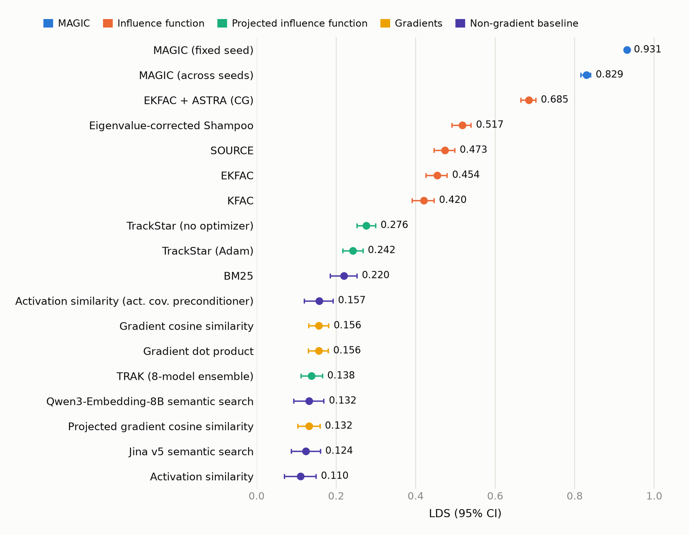
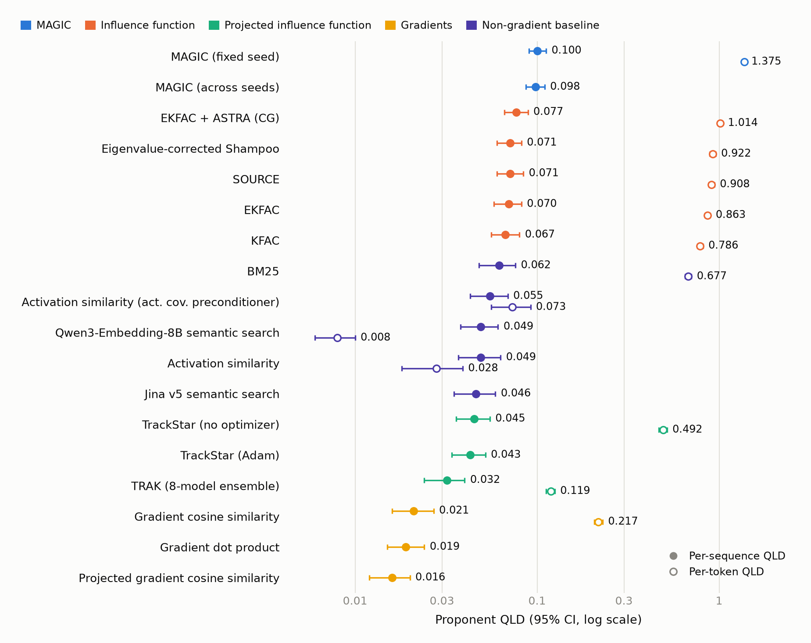

# bergson-leaderboard

Dot plots of the [Bergson finetuning leaderboard](https://bergson.readthedocs.io/en/latest/leaderboard.html):
LDS and proponent QLD per attribution method, with 95% CIs, colored by method family.
The QLD plot overlays the per-token QLD results on a log axis.

Data is transcribed from the leaderboard into `leaderboard_plots.py`; update the
`ROWS` table there when the leaderboard changes.

```bash
pip install matplotlib
python leaderboard_plots.py   # writes figures/lds_leaderboard.png and figures/qld_leaderboard.png
```




